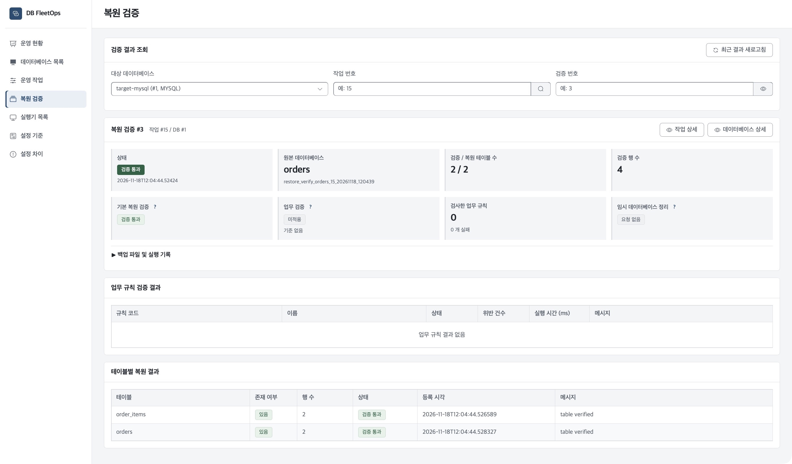
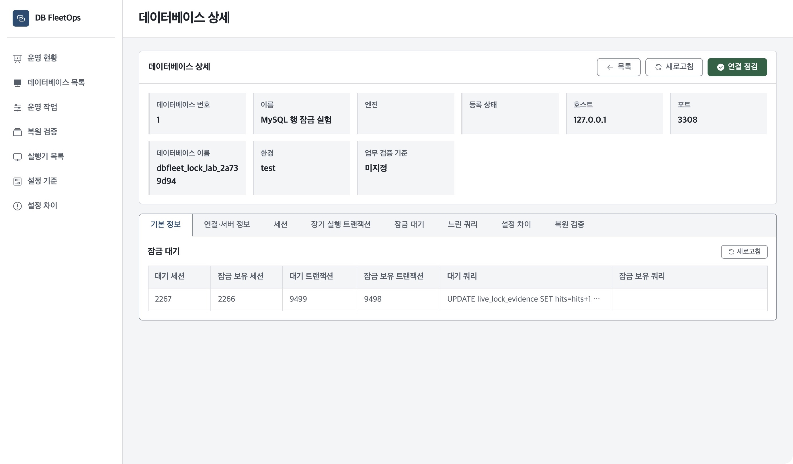
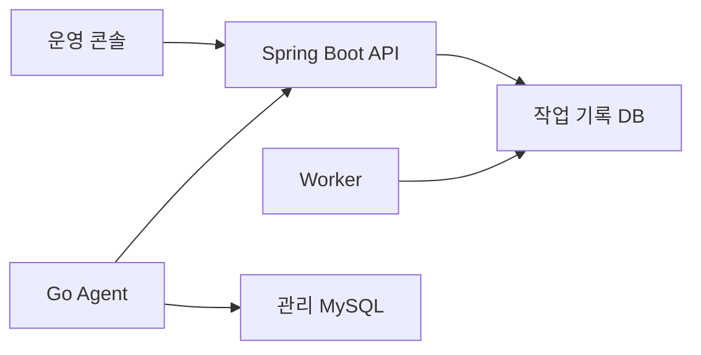

# DB FleetOps

DB FleetOps는 여러 MySQL을 관리하는 운영 도구입니다. 주문 백업을 임시 MySQL에 복원해 테이블과 데이터를 확인하고, 쓰기가 느려지면 어떤 세션이 다른 요청을 막는지 콘솔에서 찾을 수 있습니다.

## 실제로 확인한 결과

| 상황 | 구현과 결과 |
|---|---|
| 주문 백업이 실제로 복원되는지 확인 | 백업 Task를 수행한 Go Agent가 같은 파일을 임시 DB에 복원했습니다. 작업 #15에서 `orders`와 `order_items`를 각각 2행씩 확인했습니다. [복원 구현과 콘솔 증거](docs/8-백업-복원-검증-구조.md#1-백업-파일로-주문-데이터를-복원했다) |
| 파일 크기가 그대로인 손상 백업 차단 | 덤프의 SQL 값 하나를 바꾼 뒤 백업 당시 SHA-256과 비교했습니다. 불일치하면 MySQL 명령을 **0회** 호출하는 것을 Go 테스트로 확인했습니다. [차단 코드와 테스트 출력](docs/8-백업-복원-검증-구조.md#2-내용이-바뀐-덤프를-복원-전에-차단했다) |
| 실수로 삭제한 주문을 사고 직전까지 복구 | 별도 MySQL에서 전체 백업을 복원하고 삭제 직전 위치까지만 바이너리 로그를 적용하는 실험을 구성했습니다. 로컬 실행 완료를 확인했으며 해당 실행의 위치와 소요 시간은 기록하지 않았습니다. [PITR 스크립트와 확인 범위](docs/8-백업-복원-검증-구조.md#3-잘못된-삭제-직전까지-복구하는-경로를-만들었다) |
| 같은 행의 쓰기 지연 원인 확인 | MySQL 8.0에서 대기 세션과 잠금 보유 세션을 식별했습니다. 동일한 180ms 지연을 잠금 획득 앞으로 옮긴 실험에서 쓰기 p95가 **778.48ms → 220.86ms**로 줄었고, 두 조건에서 48건씩 모두 커밋됐습니다. [조회 SQL과 조치 전후 측정](docs/9-DB-FleetOps-배포와-관측성.md#12-mysql-행-잠금-장애-진단) |

### 콘솔에서 확인한 두 사례

작업 #15는 주문 테이블 2개와 행 4개를 복원했습니다. 화면에서 전체 판정과 테이블별 행 수를 확인할 수 있습니다.



잠금 실험에서 대기 세션 `2267`이 보유 세션 `2266`에 막혔습니다. 잠금을 해제한 뒤 같은 조회에서 대기 항목이 사라졌습니다. [해제 후 화면과 부하 테스트 출력](docs/9-DB-FleetOps-배포와-관측성.md#실행-결과-3-잠금-해제)



## 구조와 운영 흐름

예를 들어 운영자가 주문 DB의 백업을 요청하면 **Job** 하나가 생깁니다. Worker는 백업과 복원 검증을 각각 **Task**로 배정하고, DB 가까이에 있는 Go Agent가 Task를 가져가 실행합니다. 같은 완료 보고가 다시 도착해도 후속 Task는 한 번만 생성합니다. 콘솔은 작업 결과와 실패 원인을 보여 줍니다. [Job과 Task의 코드 흐름](docs/5-백업-Job과-Agent-Task-실행-구조.md)



설정 점검은 실제 값을 수집해 운영 기준과 비교합니다. 설정 변경은 허용된 항목과 값 형식을 확인한 뒤 적용하고, 변경 전후 값을 기록합니다. [설정 차이 점검](docs/6-Database-설정-차이-점검-구조.md) · [설정 변경의 검증 흐름](docs/7-운영-Database-설정-안전-변경-구조.md)

## 화면에서 확인할 수 있는 것

[운영 현황](docs/images/dashboard.jpg) · [데이터베이스 목록](docs/images/1-db-instance.jpg) · [데이터베이스 상세](docs/images/2-db-detail.jpg) · [운영 작업](docs/images/3-operation-job.jpg) · [실행기 목록](docs/images/4-agent-list.jpg) · [설정 기준](docs/images/5-configuration-profile.jpg) · [설정 차이](docs/images/6-configuration-drift.jpg)

## 로컬 실행

프로젝트 루트의 `.env`에 `DB_FLEETOPS_CREDENTIAL_ENCRYPTION_KEY`를 설정한 뒤 실행합니다. 기존 환경을 다시 띄울 때는 DB 비밀번호를 암호화한 기존 키를 사용합니다. [키 생성과 배포 절차](docs/9-DB-FleetOps-배포와-관측성.md#4-docker-compose-실행)

```bash
./gradlew bootJar && docker compose up --build -d
./scripts/smoke-test-compose.sh
npm --prefix db-fleetops-console ci
npm --prefix db-fleetops-console run dev
```

| 구성요소 | 기본 주소 |
|---|---|
| 운영 콘솔 | http://localhost:5173 |
| API · Worker | http://localhost:8080 · http://localhost:8081 |
| Prometheus · Grafana | http://localhost:9090 · http://localhost:3000 |

종료 명령은 `docker compose down`입니다. `-v`를 추가하면 작업 기록 DB와 Agent 데이터 볼륨까지 삭제됩니다.

### 보험 업무 규칙 실습

초기화된 테스트 DB `insurance_sandbox`에는 합성 고객·계약·청구 데이터가 있습니다. 운영 콘솔에서 `target-mysql:3306`의 `insurance_sandbox`를 등록하고, Agent와 `Insurance Sandbox V1` 프로필을 연결하면 복원본에 업무 규칙 7개를 실행합니다. 예를 들어 계약이 없는 청구를 찾아낼 수 있습니다. [시드 데이터와 오류 재현 절차](docs/db-fleet-ops_finance_insurance_roadmap.md)

```bash
./scripts/insurance-sandbox.sh verify
./scripts/insurance-sandbox.sh inject
./scripts/insurance-sandbox.sh reset
```

## 테스트와 재현

```bash
./gradlew test
./gradlew integrationTest
./gradlew agentFailureTest --rerun-tasks --console=plain
./gradlew architectureTest --rerun-tasks --console=plain
(cd agent-go && go test ./...)
python3 scripts/mysql-pitr-rehearsal.py
```

실제 MySQL과 Docker가 필요한 테스트의 실행 조건은 [테스트 가이드](docs/2-자동-테스트와-실패-재현-전략.md)에 있습니다. 행 잠금 비교 실험은 [실험 계정과 환경 변수](docs/9-DB-FleetOps-배포와-관측성.md#재실행)를 설정한 뒤 실행합니다. 위의 성능 수치는 로컬 MySQL 8.0.41의 통제된 실험에서 얻었습니다.

## 설계 문서

| 주제 | 문서 |
|---|---|
| 프로젝트 범위 | [해결하려는 문제](docs/1-DB-FleetOps가-해결하려는-문제.md) · [도메인 정리](docs/도메인%20정리.md) · [용어 정리](docs/용어%20정리.md) |
| 비동기 작업과 실행권 | [Job 구조](docs/3-비동기-작업-처리를-위한-Job-구조.md) · [중앙 관제 서버와 Go Agent](docs/4-중앙-관제-서버와-Go-Agent-분리-구조.md) · [객체 관계](docs/diagram/유스케이스별-객체-관계.md) |
| 배포와 관측 | [Compose와 Kubernetes 예제, 운영 지표](docs/9-DB-FleetOps-배포와-관측성.md) · [운영 콘솔](db-fleetops-console/README.md) |

중앙 관제 서버는 Java 21과 Spring Boot, 콘솔은 Vue 3와 TypeScript, 현장 실행기는 Go를 사용합니다. 로컬 Compose의 작업 기록 DB와 관리 대상 DB는 MySQL 8.0입니다. 운영 적용 전에는 [고가용성·보안·부하 검증 항목](docs/9-DB-FleetOps-배포와-관측성.md#11-운영-적용-전에-보완할-부분)을 확인해야 합니다.
