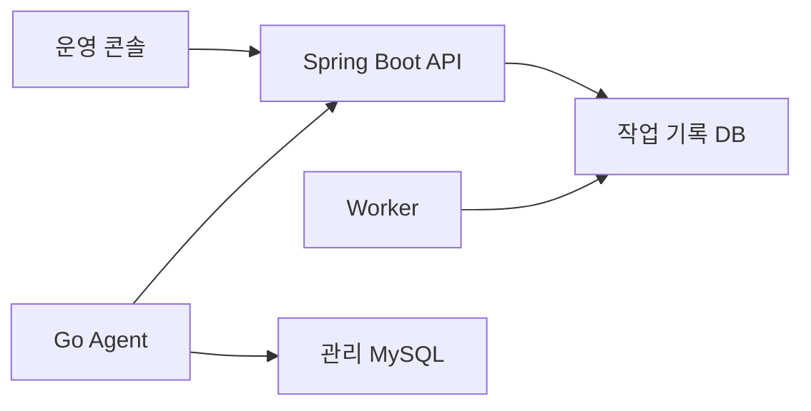

# DB FleetOps

DB FleetOps는 여러 MySQL을 관리하는 운영 도구입니다. 주문 백업을 임시 MySQL에 복원해 테이블과 데이터를 확인하고, 쓰기가 느려지면 어떤 세션이 다른 요청을 막는지 콘솔에서 찾을 수 있습니다.

## MySQL 운영 사례

### 주문 백업의 복원 검증

주문 백업에서 `orders`만 살아나고 `order_items`가 빠지면 주문 번호는 조회해도 어떤 상품을 주문했는지 확인할 수 없습니다. 그래서 주문 DB를 백업하는 작업 #15에서 두 테이블을 실제로 읽을 수 있는지 확인했습니다.

덤프를 만든 Go Agent가 같은 파일을 임시 MySQL 스키마에 넣고 테이블 이름과 행 수를 조회했습니다. 콘솔에서 `orders` 2행과 `order_items` 2행을 확인했습니다. [복원 실행 코드](agent-go/internal/infra/restore/mysql_restore_runner.go)와 [테이블 검증 코드](agent-go/internal/infra/restore/mysql_restore_verifier.go)


### 손상된 덤프의 사전 차단

덤프의 SQL을 `VALUES (1)`에서 `VALUES (2)`로 바꿔도 파일 크기는 그대로입니다. 이 경우 복원 명령이 실행되기 전에 변경을 잡기 위해, 덤프를 처음 만들 때 기록한 SHA-256을 복원 시점에 다시 계산한 값과 비교했습니다.

Go 테스트에서 값을 바꾼 덤프는 `BACKUP_INTEGRITY_CHECK_FAILED`로 중단됐습니다. 임시 DB 생성과 복원에 쓰는 MySQL 명령 호출은 **0회**였습니다. [변조 재현 테스트](agent-go/internal/infra/restore/mysql_restore_runner_test.go), [실제 테스트 출력](docs/images/8-restore-checksum-test.jpg)

### 삭제 직전 시점 복구

실험에서는 1번 주문이 있을 때 백업을 뜨고 2번과 3번 주문을 넣었습니다. 이후 3번을 삭제하고 4번을 넣었습니다. 덤프만 복원하면 백업 이후의 두 정상 주문도 함께 빠집니다.

`mysqldump`가 덤프에 기록한 위치부터 바이너리 로그를 읽고, 잘못된 삭제가 시작되는 위치에서 재생을 멈추도록 구현했습니다. 스크립트는 덤프 복원본이 **1번**, 로그 재생 복원본이 **1번, 2번, 3번**일 때 통과합니다. 로컬 실행은 완료됐으며, 해당 실행의 위치와 시간은 기록하지 않았습니다. [시점 복구 스크립트](scripts/mysql-pitr-rehearsal.py)와 [검증 범위](docs/8-백업-복원-검증-구조.md#3-잘못된-삭제-직전까지-복구하는-경로를-만들었다)

### 행 잠금 대기와 쓰기 지연 개선

한 세션이 행을 수정한 뒤 커밋을 미루자, 같은 행을 수정하려던 세션이 멈췄습니다. MySQL의 `data_lock_waits`와 `threads`를 연결해 누가 누구를 기다리는지 조회했습니다. 콘솔에서 **대기 세션 2267이 보유 세션 2266에 막힌 것**을 확인했고, 잠금을 해제하자 대기 항목이 사라졌습니다. [잠금 조회 SQL](src/main/java/com/dbfleetops/health/infra/MySqlDiagnosticAdapter.java)과 [해제 후 화면](docs/9-DB-FleetOps-배포와-관측성.md#실행-결과-3-잠금-해제)


별도 부하 실험에서 세션 4개가 같은 행을 총 48번 갱신했습니다. 잠금을 잡은 채 180ms를 기다리면 쓰기 p95가 **778.48ms**였습니다. 같은 대기를 잠금 획득 앞으로 옮기자 **220.86ms**로 줄었고, 두 조건 모두 48건이 커밋됐습니다. [부하 테스트 코드](src/test/java/com/dbfleetops/health/infra/MySqlLockWaitIntegrationTest.java)와 [실측 표](docs/9-DB-FleetOps-배포와-관측성.md#실행-결과-2-잠금-범위-변경)

## 구조와 운영 흐름

예를 들어 운영자가 주문 DB의 백업을 요청하면 **Job** 하나가 생깁니다. Worker는 백업과 복원 검증을 각각 **Task**로 배정하고, Go Agent는 DB에 접속할 수 있는 호스트에서 Task를 가져와 백업과 복원 명령을 실행합니다. 같은 완료 보고가 다시 도착해도 후속 Task는 한 번만 생성합니다. 콘솔은 작업 결과와 실패 원인을 보여 줍니다. [Job과 Task의 코드 흐름](docs/5-백업-Job과-Agent-Task-실행-구조.md)



설정 점검은 실제 값을 수집해 운영 기준과 비교합니다. 설정 변경은 허용된 항목과 값 형식을 확인한 뒤 적용하고, 변경 전후 값을 기록합니다. [설정 차이 점검](docs/6-Database-설정-차이-점검-구조.md), [설정 변경의 검증 흐름](docs/7-운영-Database-설정-안전-변경-구조.md)

### Go Agent 선택 근거

20초 동안 백업을 기다리는 동안에도 Agent는 중앙 서버에 살아 있다는 신호를 보내고, 해당 작업을 계속 실행할 권한을 갱신해야 합니다. 반대로 그 권한을 잃으면 이미 시작한 `mysqldump`를 멈춰야 합니다. 이 두 동작을 각 DB 호스트에서 지원하려고 Go를 선택했습니다. goroutine으로 생존 신호와 작업 실행을 나누고, 작업의 `context`를 OS 명령까지 전달할 수 있기 때문입니다. 두 동작은 Go 표준 라이브러리로 구현했습니다. [Agent 실행 코드](agent-go/internal/application/agent_service.go)와 [덤프 실행 코드](agent-go/internal/infra/backup/mysql_dump_runner.go)

20초 지연을 넣은 장애 재현에서 백업과 생존 신호를 같은 흐름에 뒀을 때 신호 간격이 최대 **21초**였습니다. 신호 전송을 별도 goroutine으로 옮기자 같은 실험에서 최대 **2초**로 줄었고 작업도 완료됐습니다. 중앙 서버가 실행권 충돌로 갱신을 거절하면 Agent는 작업의 `context`를 취소하고 이전 시도의 결과를 보고하지 않습니다. [Go 선택 근거와 실험 기록](docs/4-중앙-관제-서버와-Go-Agent-분리-구조.md#5-go-agent-선택-근거)

## 콘솔 화면

[운영 현황](docs/images/dashboard.jpg), [데이터베이스 목록](docs/images/1-db-instance.jpg), [데이터베이스 상세](docs/images/2-db-detail.jpg), [운영 작업](docs/images/3-operation-job.jpg), [실행기 목록](docs/images/4-agent-list.jpg), [설정 기준](docs/images/5-configuration-profile.jpg), [설정 차이](docs/images/6-configuration-drift.jpg)

## 로컬 실행

프로젝트 루트의 `.env`에 `DB_FLEETOPS_CREDENTIAL_ENCRYPTION_KEY`를 설정한 뒤 실행합니다. 기존 환경을 다시 띄울 때는 DB 비밀번호를 암호화한 기존 키를 사용합니다. [키 생성과 배포 절차](docs/9-DB-FleetOps-배포와-관측성.md#4-docker-compose-실행)

```bash
./gradlew bootJar && docker compose up --build -d
./scripts/smoke-test-compose.sh
npm --prefix db-fleetops-console ci
npm --prefix db-fleetops-console run dev
```

| 구성요소 | 기본 주소 |
|---|---|
| 운영 콘솔 | http://localhost:5173 |
| API, Worker | http://localhost:8080, http://localhost:8081 |
| Prometheus, Grafana | http://localhost:9090, http://localhost:3000 |

종료 명령은 `docker compose down`입니다. `-v`를 추가하면 작업 기록 DB와 Agent 데이터 볼륨까지 삭제됩니다.

### 보험 업무 규칙 실습

초기화된 테스트 DB `insurance_sandbox`에는 합성 고객, 계약, 청구 데이터가 있습니다. 운영 콘솔에서 `target-mysql:3306`의 `insurance_sandbox`를 등록하고, Agent와 `Insurance Sandbox V1` 프로필을 연결하면 복원본에 업무 규칙 7개를 실행합니다. 예를 들어 계약이 없는 청구를 찾아낼 수 있습니다. [시드 데이터와 오류 재현 절차](docs/db-fleet-ops_finance_insurance_roadmap.md)

```bash
./scripts/insurance-sandbox.sh verify
./scripts/insurance-sandbox.sh inject
./scripts/insurance-sandbox.sh reset
```

## 테스트와 재현

```bash
./gradlew test
./gradlew integrationTest
./gradlew agentFailureTest --rerun-tasks --console=plain
./gradlew architectureTest --rerun-tasks --console=plain
(cd agent-go && go test ./...)
python3 scripts/mysql-pitr-rehearsal.py
```

실제 MySQL과 Docker가 필요한 테스트의 실행 조건은 [테스트 가이드](docs/2-자동-테스트와-실패-재현-전략.md)에 있습니다. 행 잠금 비교 실험은 [실험 계정과 환경 변수](docs/9-DB-FleetOps-배포와-관측성.md#재실행)를 설정한 뒤 실행합니다. 위의 성능 수치는 로컬 MySQL 8.0.41의 통제된 실험에서 얻었습니다.

## 설계 문서

| 주제 | 문서 |
|---|---|
| 프로젝트 범위 | [해결하려는 문제](docs/1-DB-FleetOps가-해결하려는-문제.md), [도메인 정리](docs/도메인%20정리.md), [용어 정리](docs/용어%20정리.md) |
| 비동기 작업과 실행권 | [Job 구조](docs/3-비동기-작업-처리를-위한-Job-구조.md), [중앙 관제 서버와 Go Agent](docs/4-중앙-관제-서버와-Go-Agent-분리-구조.md), [객체 관계](docs/diagram/유스케이스별-객체-관계.md) |
| 배포와 관측 | [Compose와 Kubernetes 예제, 운영 지표](docs/9-DB-FleetOps-배포와-관측성.md), [운영 콘솔](db-fleetops-console/README.md) |

중앙 관제 서버는 Java 21과 Spring Boot를 사용하고, 콘솔은 Vue 3와 TypeScript를 사용합니다. 로컬 Compose의 작업 기록 DB와 관리 대상 DB는 MySQL 8.0입니다. 운영 적용 전에는 [고가용성, 보안, 부하 검증 항목](docs/9-DB-FleetOps-배포와-관측성.md#11-운영-적용-전에-보완할-부분)을 확인해야 합니다.
