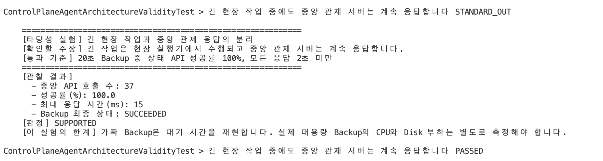
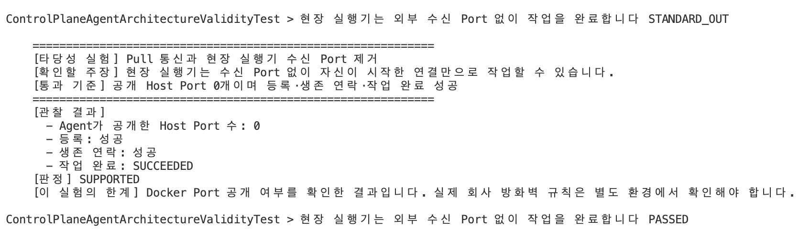
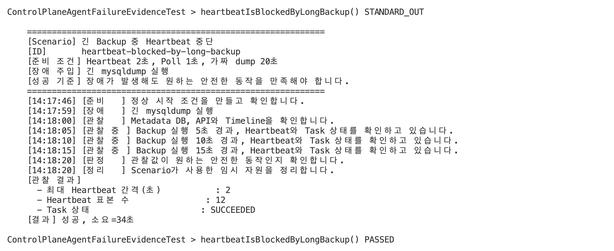
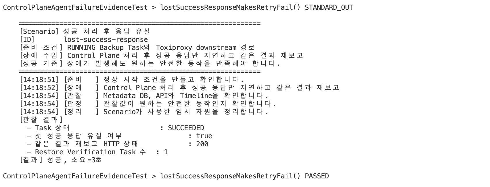

# 중앙 관제 서버와 Go Agent 분리 구조

## 1. 결론

중앙 관제 서버(Control Plane)는 작업 순서와 상태를 관리합니다. Go Agent는 DB에 접속할 수 있는 호스트에서 작업을 받아 MySQL 백업과 복원 명령을 실행합니다.

실험에서 다음 장점을 확인했습니다.

- Agent가 긴 작업을 수행해도 중앙 관제 서버는 계속 응답했습니다.
- Agent는 외부 수신 Port 없이 작업을 받아 완료했습니다.
- Agent 하나를 강제로 종료해도 다른 Agent와 중앙 관제 서버는 계속 동작했습니다.
- 중앙 관제 서버를 재시작해도 작업 장부는 남았습니다.
- Go Agent는 프로젝트에서 정한 배포와 실행 기준을 만족했습니다.

백업 중 Heartbeat 중단, Agent 종료 후 Task 정체, 동시 Poll 중복 선점, 완료 응답 유실 후 재전송 결과는 8절에 정리했습니다.

## 2. 각 구성요소가 맡은 일

### 중앙 관제 서버

중앙 관제 서버는 전체 작업의 목적과 상태를 관리합니다.

- 관리 대상 데이터베이스를 관리합니다.
- 사용자가 요청한 전체 작업인 `OperationJob`을 관리합니다.
- Agent가 처리할 작업인 `OperationTask`를 만듭니다.
- Agent의 등록과 생존 연락을 받습니다.
- 작업 시작과 완료 결과를 작업 장부에 저장합니다.

### Worker

Worker는 실행할 수 있는 `OperationJob`을 선점해 전체 순서를 진행합니다.

예를 들어 백업 작업이라면 백업 파일 생성이 끝난 뒤 복원 확인 작업이 이어지도록 조정합니다.

### Go Agent

Agent는 자신에게 배정된 작업을 조회하고 실제 명령을 실행합니다.

현재 실행할 수 있는 작업은 다음과 같습니다.

- Linux 상태 수집
- MySQL 논리 백업
- MySQL 백업 복원 확인

Agent는 중앙 관제 서버처럼 전체 작업의 성공 여부를 판단하지 않습니다. 자신이 맡은 하나의 작업을 실행하고 결과만 보고합니다.

## 3. 왜 분리했는가

Linux 상태 수집과 MySQL 백업은 실제 데이터베이스가 운영되는 환경 가까이에서 수행해야 합니다.

중앙 관제 서버가 모든 데이터베이스 Host에 직접 접속해 명령을 실행하면 중앙 서버가 다음 내용을 모두 책임져야 합니다.

- 각 Host로 들어가는 통신 경로
- 데이터베이스 인증 정보
- `mysqldump`와 `mysql` 같은 실행 도구
- 백업 파일을 저장할 위치
- Host마다 다른 운영체제 환경

Agent를 분리하면 중앙 관제 서버는 “무엇을 해야 하는가”를 관리하고, Agent는 “현장에서 어떻게 실행하는가”를 담당합니다.

```text
사용자 요청
  → 중앙 관제 서버가 전체 작업을 기록합니다
  → Worker가 실행 순서를 정합니다
  → Agent가 자신에게 배정된 작업을 조회합니다
  → Agent가 실제 명령을 실행합니다
  → 결과를 중앙 관제 서버에 보고합니다
```

실제 실험에서도 20초짜리 백업이 Agent에서 수행되는 동안 중앙 관제 서버의 상태 API는 100% 응답했습니다. 세 번 실행하는 동안 가장 느린 응답은 15ms였습니다.



따라서 긴 작업을 중앙 관제 서버와 다른 Process에서 실행한다는 장점은 확인되었습니다.

## 4. Agent의 Task 선점

현재 구조에서는 중앙 관제 서버가 Agent에 직접 접속하여 작업을 밀어 넣지 않습니다. Agent가 중앙 관제 서버에 다음 작업을 물어봅니다. 이를 Pull 방식이라고 합니다.

```text
Agent
  → 등록합니다
  → 생존 연락을 보냅니다
  → 다음 작업을 물어봅니다
  → 작업 Lease를 갱신하고 결과를 보고합니다
```

택배 기사가 본사에 전화해 다음 배송 건을 받아가는 것과 같습니다. 본사가 기사 개인 기기에 직접 접속할 필요가 없습니다.

실험에서는 Agent의 외부 공개 Port를 0개로 두었습니다. 이 상태에서도 다음 과정이 모두 성공했습니다.



- Agent 등록
- 생존 연락
- 작업 조회
- 백업 실행
- 작업 완료 보고

따라서 Agent가 먼저 시작한 연결만으로 전체 작업 흐름이 동작한다는 사실을 확인했습니다.

## 5. Go Agent 선택 근거

**결정.** 중앙 관제 서버는 Spring Boot로 유지하고, DB 호스트에서 MySQL 명령을 실행하는 Agent는 Go로 구현했다. 언어 선택의 기준은 백업 중에도 제어 요청을 계속 보내고, 실행권을 잃었을 때 진행 중인 백업 명령을 중단하며, Linux 호스트에 Agent를 별도로 배포할 수 있는지였다.

### 백업과 제어 요청의 실행 분리

정상 동작에서 하나의 Agent는 다음 세 가지를 처리한다.

| 동작 | 유지 기간 | 늦어질 때 생기는 일 |
|---|---|---|
| Heartbeat | Agent가 실행되는 동안 | 중앙 서버에서 살아 있는 Agent의 마지막 응답 시각이 오래된 값으로 남는다. |
| Task Lease 갱신 | 해당 실행 시도가 유효한 동안 | 백업 프로세스가 여전히 돌아가도 서버가 실행권 만료로 판단해 같은 작업을 다시 대기열에 넣을 수 있다. |
| MySQL 명령 실행 | 명령 종료 또는 작업 취소까지 | 덤프가 끝날 때까지 기다리는 시간이 두 제어 요청의 주기에 영향을 줄 수 있다. |

예를 들어 `mysqldump`를 호출한 루프에서 명령이 끝난 다음 Heartbeat를 보내면 20초짜리 명령을 기다리는 동안 신호를 보낼 기회가 없다. 실제로 같은 흐름에 두었을 때 Heartbeat 최대 간격이 21초였다. `AgentService.Run()`은 Agent 수명의 goroutine에서 Heartbeat 타이머를 돌리고, 호출 흐름에서는 Task를 하나씩 받아 실행한다. `PollAndHandleTask()`는 실행 시도마다 수명이 짧은 Lease 갱신 goroutine을 시작한다. 이렇게 하면 하나의 Agent가 여러 덤프를 동시에 돌리지 않으면서도, 덤프를 기다리는 동안 제어 요청을 보낼 수 있다. [Agent 제어 흐름](../agent-go/internal/application/agent_service.go)

goroutine을 고른 이유는 이 작업 모델에서 타이머와 HTTP 요청이 기다리는 동안 별도 루프를 유지하기 쉽고, 중단 범위를 `context`로 전달할 수 있어서다. Agent의 종료 신호는 상위 `context`를 취소해 Agent 수명의 작업에 전달한다. 반면 Task의 실행권 충돌은 그 시도의 하위 `context`만 취소해 Heartbeat를 계속 보낼 수 있게 한다. 타이머 간격이 응답 시간을 보장하는 것은 아니다. 실제 HTTP 지연과 타임아웃도 보고 간격에 영향을 준다. [종료 신호 처리](../agent-go/cmd/db-fleet-agent/main.go)와 [HTTP 클라이언트](../agent-go/internal/infra/http/control_plane_client.go)

### 실행권 상실과 OS 프로세스 취소

같은 Task의 첫 번째 시도에서 `mysqldump`가 파일을 쓰고 있다고 가정한다. 실행권 갱신이 충돌로 거절되면 갱신 goroutine은 상실 사실을 채널에 기록하고 작업의 `context`를 취소한다. [MySQLDumpRunner](../agent-go/internal/infra/backup/mysql_dump_runner.go)는 그 `context`를 `exec.CommandContext`에 넘겼기 때문에, 취소되면 Go가 시작한 `mysqldump` 프로세스도 종료된다. 덤프의 표준 출력은 파일에 직접 연결한다. Agent가 전체 SQL 덤프를 메모리 버퍼에 받은 뒤 쓰는 방식은 필요하지 않다. [Go 프로세스 취소 동작](https://pkg.go.dev/os/exec#CommandContext)

명령에서 돌아온 Agent는 갱신 goroutine이 끝날 때까지 기다리고, 실행권 상실이 기록된 시도는 성공이나 실패를 보고하지 않는다. 네트워크 지연으로 이전 시도의 보고가 뒤늦게 도착하는 경우까지 처리하려면 중앙 서버도 실행 번호를 확인해야 한다. 프로세스를 중단해도 이미 디스크에 쓴 바이트가 되돌아가지는 않는다. [실행 번호와 상태 검사](../src/main/java/com/dbfleetops/operation/task/domain/OperationTask.java)

### 대안과 선택 비용

| 대안 | 구현 방식 | 이 프로젝트의 비용 |
|---|---|---|
| Java 21 Agent | `ScheduledExecutorService`로 두 주기 작업을 돌리고, `ProcessBuilder`로 시작한 프로세스의 핸들을 보관한다. Task 취소 때 프로세스를 직접 종료하고 종료 여부를 확인한다. | Java 코드를 재사용할 수 있다. 별도 Agent의 Java 런타임과 배포물을 관리하고, 스케줄러의 작업 취소를 OS 프로세스 종료까지 연결해야 한다. |
| Go Agent | goroutine과 `time.Ticker`로 제어 요청을 실행한다. 작업 수명의 `context`를 HTTP 요청과 OS 명령에 전달한다. `CGO_ENABLED=0`으로 Linux 실행 파일을 빌드한다. | Java와 Go의 빌드 및 배포를 관리하고 Task 계약 변경을 양쪽에 반영해야 한다. MySQL 클라이언트 도구는 배포 환경에 포함해야 한다. |

Java에서도 같은 동시성 구조를 만들 수 있다. Go의 선택 근거는 이 Agent가 하는 일이 HTTP 요청, 타이머, OS 명령에 집중돼 있어 **작업 취소를 표준 라이브러리로 명령 실행까지 연결하고, 별도의 JVM 없이 배포하는 조합이 이 구현에 잘 맞았다는 점**이다. 중앙 서버에서 쓰는 Spring Boot의 작업 저장이나 트랜잭션 코드는 Agent에 필요하지 않았다. [Java 주기 작업 API](https://docs.oracle.com/en/java/javase/21/docs/api/java.base/java/util/concurrent/ScheduledExecutorService.html)와 [Java 프로세스 종료 API](https://docs.oracle.com/en/java/javase/21/docs/api/java.base/java/lang/Process.html)

### 검증 결과와 범위

- **Heartbeat 간격.** 20초 지연을 넣은 백업에서 루프를 분리한 뒤 최대 간격은 21초에서 2초로 줄었고 Task는 성공했다. 결과가 보여 주는 것은 실행 분리의 효과다. 실험용 명령이 대기 시간을 재현했으므로 실제 대용량 백업의 CPU와 디스크 부하는 이 실험으로 측정하지 않았다. [장애 재현 테스트](../src/failureTest/java/com/dbfleetops/failure/scenario/AgentFailureTest.java)
- **실행권 충돌.** Go 단위 테스트에서 긴 작업 도중 갱신이 반복되는지 확인한 뒤, 서버가 충돌을 반환하도록 해 Handler가 취소되고 성공과 실패 보고가 모두 생략되는지 확인했다. 이 테스트에서는 Handler를 대체했다. 실제 `mysqldump`가 취소 신호를 받아 종료하기까지 걸리는 시간은 별도로 측정하지 않았다. [Lease 갱신 및 취소 테스트](../agent-go/internal/application/agent_service_test.go)

빌드와 시작 조건은 [AgentRuntimeCheck](../src/failureTest/java/com/dbfleetops/failure/validity/AgentRuntimeCheck.java)에 고정했다.

| 확인 항목 | 기준 | 실험 결과 |
|---|---|---|
| Go 실행 파일 크기 | 25MiB 이하 | 9.07MiB |
| 유휴 프로세스 메모리 | 40MiB 이하 | 7.11MiB |
| 컨테이너 시작 시간 | 15초 미만 | 9.709초 |
| Linux amd64와 arm64 빌드 | 두 대상 모두 성공 | 통과 |

MySQL 도구를 포함한 실험 이미지 전체 크기는 581.43MiB였다. 같은 기능의 Java Agent를 만들어 비교한 실험은 수행하지 않았다. [실행 환경 측정 원본](images/image-4.png)

## 6. 전체 작업과 현장 작업을 나눈 이유

`OperationJob`은 사용자가 원하는 전체 목적입니다. `OperationTask`는 그 목적을 이루기 위해 Agent가 처리하는 하나의 작업입니다.

예를 들어 사용자는 “백업이 실제로 복원 가능한지 확인해 주세요”라고 요청할 수 있습니다.

```text
OperationJob: 백업과 복원 확인
  ├── OperationTask: MySQL 백업 파일 생성
  └── OperationTask: 백업 파일 복원 확인
```

백업 파일 생성은 성공해도 복원 확인은 실패할 수 있습니다. 전체 목적과 개별 실행 결과를 나누어야 어느 단계에서 문제가 발생했는지 알 수 있습니다.

중앙 관제 서버를 재시작하는 실험에서도 작업 상태와 Task ID가 그대로 유지되었습니다. 작업 장부가 중앙 관제 Process와 별도로 저장된다는 사실을 확인했습니다.


## 7. 임의 명령을 실행하지 않는 이유

Agent는 중앙 관제 서버가 보낸 임의의 Shell 명령을 그대로 실행하지 않습니다. 미리 구현된 작업 종류만 실행합니다.

예를 들어 중앙 관제 서버가 다음 문자열을 보내고 Agent가 그대로 실행하는 구조는 사용하지 않습니다.

```json
{
  "command": "임의의 shell command"
}
```

현재 Agent는 등록된 Handler가 지원하는 작업 종류만 실행합니다. `mysqldump`를 실행할 때도 Shell 문자열을 조합하지 않고 프로그램 이름과 인자를 나누어 전달합니다.

이는 Agent가 원격 Shell처럼 사용되는 범위를 줄입니다.

## 8. 작업 전달 실패를 어떻게 해결했는가

### 8.1 긴 백업 중 Heartbeat 중단

기존에는 Heartbeat와 작업 실행이 같은 흐름에 있어, 20초 백업 중 Heartbeat 간격이 21초까지 늘어났습니다.

Heartbeat와 작업 실행을 별도 goroutine으로 분리했습니다. 변경 후 같은 실험에서 최대 Heartbeat 간격은 2초였고 Task도 `SUCCEEDED`로 완료되었습니다.

코드는 간단히 다음처럼 나누었습니다.

```text
AgentService.Run(...)
  ├─ runHeartbeatLoop(...) : Heartbeat만 계속 전송
  └─ PollAndHandleTask(...) : Task 조회와 실행 담당
```

즉, 작업이 오래 걸려도 Heartbeat goroutine은 기다리지 않고 별도로 움직입니다.



### 8.2 Agent 종료 후 `RUNNING` Task 정체

Task를 선점할 때 다음 실행 정보를 저장하도록 변경했습니다.

- `executionAttempt`: 현재 실행 시도 횟수
- `leaseExpiresAt`: 실행 권한 만료 시각
- `lastProgressAt`: 마지막 Lease 갱신 시각

Agent는 작업 중 20초마다 60초 Lease를 갱신합니다. Agent가 종료되어 갱신하지 못하면 중앙 관제 서버가 Task를 `QUEUED`로 되돌립니다. 같은 Agent를 다시 시작한 실험에서는 동일한 Task ID를 실행 횟수를 2로 다시 받아 `SUCCEEDED`로 완료했습니다.


이 과정에서도 다른 Agent의 Task는 `SUCCEEDED`로 완료됐고 중앙 상태 API는 HTTP 200을 유지했습니다.

최초 실행을 포함해 세 번 모두 Lease가 만료되면 Task와 연결된 `OperationJob`을 `TIMED_OUT`으로 종료합니다. 이전 실행 번호로 뒤늦게 도착한 갱신·완료·실패 요청은 HTTP 409로 거절합니다.

코드는 다음 역할로 나누었습니다.

- Go Agent의 `maintainTaskLease(...)`가 작업 중 Lease를 주기적으로 갱신합니다.
- `ExpiredOperationTaskScheduler`가 일정 시간마다 만료 Task 검사를 시작합니다.
- `ExpiredOperationTaskService`가 만료 Task를 Lock으로 조회해 재대기 또는 최종 시간 초과를 결정합니다.
- `OperationTask`가 `requeueExpiredLease(...)`, `timeoutExpiredLease(...)`로 실제 상태를 변경합니다.

쉽게 말하면 Agent는 “아직 작업 중”이라고 계속 알리고, 중앙 서버는 연락이 끊긴 Task를 찾아 다시 실행할 수 있게 정리합니다.

### 8.3 동시 Poll의 중복 Task 반환

기존에는 Task 조회와 시작이 나뉘어 있어 두 Poll이 같은 `QUEUED` Task를 받을 수 있었습니다.

현재는 `POST /tasks/next`가 다음 과정을 하나의 Transaction에서 처리합니다.

```text
QUEUED Task 조회와 Lock
  → RUNNING 전환
  → 실행 번호 증가와 Lease 설정
  → 선점한 Task 반환
```

같은 Agent로 두 Poll을 동시에 보내는 실험을 20회 반복한 결과, 같은 Task가 두 요청에 반환된 횟수는 0회였습니다.


코드는 다음 역할로 나누었습니다.

- `AgentOperationTaskController.nextTask(...)`가 `POST /tasks/next` 요청을 받습니다.
- `TaskAcquisitionService.acquireNext(...)`가 Agent Token을 확인하고 선점 Transaction을 관리합니다.
- `OperationTaskRepository.findTop1ByAgentIdAndStatusOrderByCreatedAtAsc(...)`가 `PESSIMISTIC_WRITE` Lock으로 가장 오래된 `QUEUED` Task를 하나만 조회합니다.
- `OperationTask.acquire(...)`이 상태를 `RUNNING`으로 바꾸고 실행 번호와 Lease 시각을 기록합니다.

Controller는 HTTP 요청만 받고, 선점 순서는 Service가 관리하며, 상태 변경 규칙은 `OperationTask` 안에 둔 구조입니다.

### 8.4 완료 응답 유실 뒤 같은 결과 재전송

성공·실패 요청에 Agent가 만든 `resultReportId` UUID를 포함하고, 중앙 관제 서버는 실행 번호, 결과 종류와 결과 내용의 SHA-256을 Task에 저장합니다.

이미 끝난 Task에 같은 실행 번호·UUID·종류·내용이 다시 오면 기존 결과를 HTTP 200으로 반환합니다. 이때 상태 변경, Host Metric 저장과 복원 확인 Task 생성을 다시 실행하지 않습니다. UUID나 내용이 다르면 HTTP 409로 거절합니다.

응답만 유실한 뒤 같은 성공 결과를 다시 보낸 실험에서 재요청은 HTTP 200을 받았고, 복원 확인 Task는 한 개만 생성되어 테스트가 성공했습니다.

코드는 다음 순서로 처리합니다.

```text
완료·실패 요청
  → OperationTaskService가 Task 행을 Lock
  → OperationTaskResultFingerprint가 결과 내용의 SHA-256 계산
  → OperationTask가 최초 보고인지 같은 보고의 재전송인지 판단
  → 최초 보고만 상태 변경과 후속 작업 수행
```

- `OperationTask.acceptSuccessReport(...)`와 `acceptFailureReport(...)`가 `ACCEPTED` 또는 `DUPLICATE`를 반환합니다.
- `OperationTaskService`는 `DUPLICATE`이면 즉시 기존 결과를 반환하므로 Metric과 복원 확인 Task를 다시 만들지 않습니다.

즉, 같은 영수증 번호와 같은 내용을 다시 보내면 이미 처리한 요청으로 보고 기존 답을 돌려주는 구조입니다.



## 9. 실행 방법

### 분리 구조의 장점 확인

```bash
FAILURE_TEST_REQUIRE_DOCKER=true \
./gradlew architectureTest --rerun-tasks --console=plain
```

현재 다섯 실험이 모두 성공합니다.

### 작업 전달 실패 확인

```bash
FAILURE_TEST_REQUIRE_DOCKER=true \
./gradlew agentFailureTest --rerun-tasks --console=plain
```

Heartbeat, Lease 회수, 동시 선점, 완료 응답 유실 후 결과 재전송 실험이 모두 성공합니다.

## 10. 결론

중앙 관제 서버와 Agent를 분리한 구조는 현재 실험 범위에서 목적에 맞습니다.

- 긴 현장 작업이 중앙 관제 서버의 응답을 막지 않았습니다.
- 외부 수신 Port 없이 Pull 방식으로 작업을 완료했습니다.
- 한 Agent의 장애가 다른 Agent와 중앙 서버를 중단시키지 않았습니다.
- 중앙 서버를 재시작해도 작업 장부가 유지되었습니다.
- Go Agent는 정한 배포 기준을 만족했습니다.

생존 연락 분리, Task Lease, 실행 번호, 원자적 선점과 결과 보고 멱등 처리를 보완했습니다.
