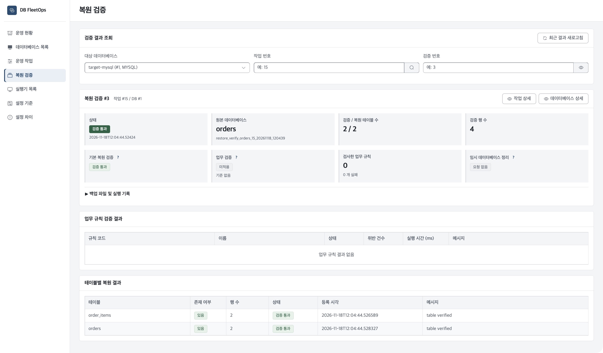
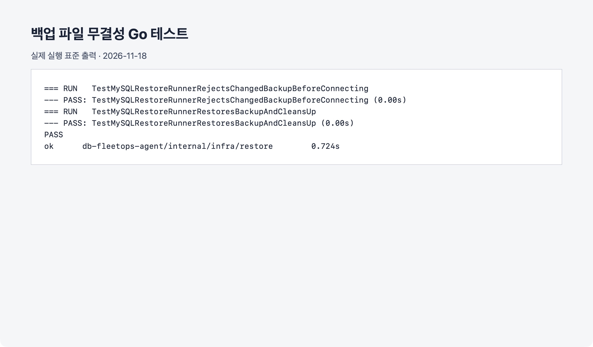
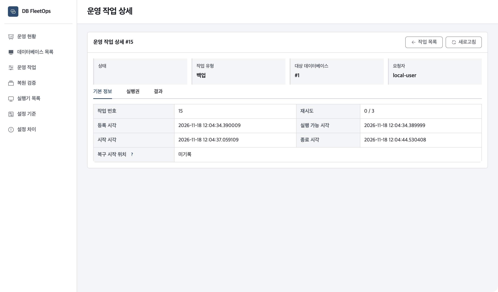

# 백업 복원 검증과 MySQL 시점 복구

주문 백업을 실제 MySQL에 복원해 테이블 2개와 행 4개를 확인했다. 백업 파일 내용이 바뀐 경우에는 복원 명령을 한 번도 호출하지 않는 것을 자동 테스트로 검증했다. 별도 시점 복구 실험에서는 전체 백업 이후의 변경을 바이너리 로그로 다시 적용하는 절차를 구성했다.

| 확인할 질문 | 결과 |
|---|---|
| 주문 백업을 실제로 읽을 수 있었나? | 작업 #15, 검증 #3에서 테이블 2/2개와 행 4개를 확인했다. |
| 백업 파일이 달라지면 복원을 막는가? | Go 테스트에서 해시 불일치 시 MySQL 명령 호출이 0회였다. |
| 삭제 직전 상태로 돌아갈 수 있는가? | 로컬 Mac에서 시점 복구 실험을 완료했다는 사용자 확인을 받았다. 해당 실행의 원본 로그와 캡처는 확보하지 않았다. |
| 위치 정보가 없는 기존 백업도 볼 수 있는가? | 작업 #15를 새 API로 읽어 HTTP 204와 콘솔의 `미기록`을 확인했다. |

## 1. 백업 파일로 주문 데이터를 복원했다

### 상황과 목표

주문 백업 파일이 있어도 실제로 복원되는지, 주문 상세까지 들어 있는지는 파일 이름만으로 알 수 없다. 운영 DB에 덮어쓰지 않고 별도 DB에 복원한 뒤 `orders`와 `order_items`를 읽는 것이 목표였다.

### 구현

1. [BackupWorkflow](../src/main/java/com/dbfleetops/operation/workflow/backup/BackupWorkflow.java)는 백업 Task가 성공하면 같은 Agent에 복원 검증 Task를 배정한다. 백업 파일이 해당 Agent의 로컬 경로에 있기 때문이다. [RestoreVerifyTaskPayloadFactory](../src/main/java/com/dbfleetops/backup/application/RestoreVerifyTaskPayloadFactory.java)는 파일 경로와 백업 시 기록한 SHA-256을 넘긴다.
2. [MySQLRestoreRunner](../agent-go/internal/infra/restore/mysql_restore_runner.go)는 지정된 해시를 확인한 뒤 검증용 DB를 만들고 열린 파일을 MySQL에 전달한다. [MySQLRestoreVerifier](../agent-go/internal/infra/restore/mysql_restore_verifier.go)는 지정된 테이블이 모두 있는지 확인하고, 요청에 따라 행 수를 조회한다. 예를 들어 `orders`가 있어도 `order_items`가 빠졌으면 테이블 검증에 실패한다.
3. 보험 프로필을 연결하면 [MySQLBusinessVerifier](../agent-go/internal/infra/restore/mysql_business_verifier.go)가 읽기 전용 규칙을 실행한다. 예를 들어 청구 행이 존재해도 연결할 계약이 없으면 위반으로 기록한다. 규칙은 실행 전에 고정하며 각 규칙에서 단일 비음수 위반 건수를 받는다.
4. [MySQLRestoreVerifyHandler](../agent-go/internal/task/mysql_restore_verify_handler.go)는 정리 상태와 검증 결과를 보고한다. [결과 저장 코드](../src/main/java/com/dbfleetops/backup/application/BackupRestoreVerificationResultRecorder.java)는 테이블·규칙별 결과를 남기고, [조회 코드](../src/main/java/com/dbfleetops/backup/application/BackupRestoreVerificationQueryService.java)는 작업·검증·DB 기준으로 결과를 읽는다. 검증이나 정리가 실패하면 백업 작업도 실패 상태가 된다.

### 실행 결과

작업 #15의 `orders` 백업을 임시 DB에 복원했다. `orders`와 `order_items`를 각각 2행씩 읽었고, 콘솔과 `GET /api/v1/jobs/15/restore-verification`의 검증 결과가 일치했다. 이 작업의 화면에는 업무 검증 미적용과 정리 요청 없음이 표시됐다.

## 2. 내용이 바뀐 덤프를 복원 전에 차단했다

### 상황과 목표

백업 SQL의 주문 금액이 `10000`에서 `90000`으로 바뀌면 파일 크기와 행 수가 그대로일 수 있다. 파일 손상을 찾아내고, 확인하지 못한 데이터를 임시 DB에 넣기 전에 멈춰야 했다.

### 구현

[복원 실행 코드](../agent-go/internal/infra/restore/mysql_restore_runner.go)의 `verifyBackupChecksum()`은 열린 파일을 읽어 백업 당시 해시와 비교한다. 일치하면 같은 파일을 되감아 MySQL에 전달하므로 해시 확인과 실행 사이에 경로가 교체돼도 다른 파일을 다시 열지 않는다. 발행 후 파일 자체가 수정되지 않고 기록한 해시를 신뢰할 수 있어야 한다.

| 입력 또는 결과 | 처리와 이유 |
|---|---|
| 해시 일치 | 임시 DB를 만들고 복원한다. 실제 테이블과 행은 이 단계에서 확인한다. |
| 해시 불일치 또는 확인 오류 | `BACKUP_INTEGRITY_CHECK_FAILED`로 중단한다. 임시 DB 생성 전이라 정리를 요청했어도 `SKIPPED`다. |
| 기존 Task에 해시 없음 | 이전 작업과의 호환성을 위해 복원을 진행한다. 백업 시점 파일과의 일치는 확인할 수 없다. |
| 임시 DB 생성 뒤 실패 | 정리를 요청했다면 삭제를 시도한다. 검증을 통과하고 삭제만 실패하면 `CLEANUP_FAILED`로 보고한다. |

### 실행 결과

[Go 테스트](../agent-go/internal/infra/restore/mysql_restore_runner_test.go)에서 덤프의 값 하나를 바꿨을 때 MySQL 명령 호출이 0회임을 확인했다. 정상 덤프의 복원 및 정리 명령 테스트도 통과했다. 손상 파일을 실제 작업에 주입해 실패 상태를 콘솔에서 확인하는 검증은 남아 있다.

## 3. 잘못된 삭제 직전까지 복구하는 경로를 만들었다

### 상황과 목표

백업에 주문 1번만 들어 있고 그 뒤에 주문 2번과 3번을 추가했다고 가정했다. 실수로 3번을 삭제하고 4번을 추가했다면, 삭제 직전 복구본에는 1·2·3번이 있어야 한다. 같은 덤프를 두 번 복원해 로그 재생 유무에 따른 차이를 확인한다.

### 구현

1. [실험 스크립트](../scripts/mysql-pitr-rehearsal.py)의 `dump_position()`은 `mysqldump --source-data=2 --single-transaction`이 덤프에 적은 파일명과 바이트 위치를 읽는다. 이 위치가 백업 다음 변경부터 읽을 기준이다. 실험은 삭제 직전 서버 위치를 기록하고 로그를 회전시킨 뒤 닫힌 파일을 원본 컨테이너에서 읽는다.
2. `prepare_replay()`는 파일명·SHA-256·실제 이벤트 경계를 검사한다. 누락·손상, 다른 파일을 가리키는 위치 또는 이벤트 중간 위치는 재생 전에 차단한다. `mysqlbinlog --stop-position`에 삭제 시작 위치를 주고 그 이벤트부터 제외한다. 로그가 원본 스키마 이름을 참조할 수 있어 원본과 UUID가 다른 복원 서버에서 재생한다.
3. [Go 백업 실행기](../agent-go/internal/infra/backup/mysql_dump_runner.go)는 `BACKUP_CAPTURE_BINLOG_POSITION=true`일 때 덤프의 위치를 백업 Task 결과에 함께 남긴다. MySQL 로그 활성화와 추가 권한이 필요하고 백업 시작에 짧은 잠금이 생길 수 있어 기본값은 꺼 두었다.
4. [작업 조회 서비스](../src/main/java/com/dbfleetops/operation/job/application/service/JobService.java)와 [작업 상세 화면](../db-fleetops-console/src/pages/OperationJobDetailPage.vue)은 Task 결과를 읽어 `복구 시작 위치`에 표시한다. 오래된 백업에 값이 없다면 조회 API는 HTTP 204를 반환한다.

### 실행 결과와 남은 확인

| 검증 항목 | 판정 기준 및 확인 범위 |
|---|---|
| 덤프만 복원 | 스크립트의 합격 기준은 1번 행이다. |
| 로그 재생 | 스크립트는 1·2·3번의 ID와 값, 4번의 부재를 확인하고 복원별 소요 시간을 출력한다. 로컬 실행은 사용자 확인으로 기록했다. 실제 로그 위치와 시간은 원본 출력이 없어 기재하지 않았다. |
| 기존 백업 | 작업 #15의 실제 기록에서 API 204와 콘솔의 `미기록`을 확인했다. |
| 새 백업 | 위치 기록을 켠 새 작업의 콘솔·API 값이 실제 덤프 주석과 일치하는지 대조가 남아 있다. |

### 재실행

프로젝트 루트에서 `python3 scripts/mysql-pitr-rehearsal.py`를 실행한다. 스크립트는 `docker compose` 또는 `docker-compose`를 사용하고 별도의 원본·복원 컨테이너를 만든 뒤 정리한다. 복원에 쓰는 `mysql:8.0-debian` 이미지는 `linux/amd64`로 실행된다. Apple Silicon에서는 에뮬레이션이 실험 시간에 영향을 줄 수 있다.

새 백업의 시작 위치는 API·Worker·Agent를 새 코드로 실행한 뒤 확인한다. 백업 Agent를 `BACKUP_CAPTURE_BINLOG_POSITION=true`로 시작하고, 로그 조회 권한이 있는 테스트 DB를 백업한다. `GET /api/v1/jobs/{jobId}/backup-binlog-position`과 작업 상세에 나온 값이 실제 덤프의 파일명·위치와 같은지 확인한다.

## 적용 범위

복원 검증은 동일 파일 여부, 테이블 존재, 선택한 행 수와 업무 규칙을 확인한다. 원본 행별 비교나 MySQL 객체·권한 전체 검증, 다중 로그 파일 시점 복구, 운영 서비스 전환과 복구 시간은 별도 과제다. 작업과 실행권의 연결은 [백업 실행 구조](5-백업-Job과-Agent-Task-실행-구조.md), 조회 응답은 [복원 검증 API](api/restore-verification-api.md)에 있다.

[MySQL 백업 옵션](https://dev.mysql.com/doc/refman/8.0/en/mysqldump.html) · [이벤트 위치 기반 시점 복구](https://dev.mysql.com/doc/refman/8.0/en/point-in-time-recovery-positions.html)
